# Tumour-derived CTGF/CCN2 and myofibroblastic CAF activation in pancreatic ductal adenocarcinoma: a multi-cohort single-cell, single-nucleus and spatial analysis

**Authors:** Md Rasheduzzaman, A.K.M Zakir Hossain, Prof. Akira Kobayashi  
**Affiliations:** University of Greifswald, University of Kyoto  
**Corresponding author:** Md Rasheduzzaman

> ✅ **VALIDATED (2026-09-07) — the numbers below are from the corrected full run.**
> - **The de-circularised axis holds.** With a **CCN2-free** TGF-β endpoint, malignant-CTGF ↔ CAF-TGF-β is **ρ = 0.741 (BH-adjusted *P* = 0.037, survives correction; n = 12)** — and the CCN-*containing* sensitivity score gives an **identical ρ = 0.741**, so the association was **not** a CCN self-correlation artefact. It is subtype-adjusted (partial ρ = 0.94), permutation- (*P* = 0.007) and leave-one-out-robust.
> - **The donor-level DE is underpowered:** with the pseudoreplication-free paired test, **0 genes survive genome-wide BH** at 10 paired patients (CTGF is up in 10/10) — the earlier cell-level "63 DEGs" was pseudoreplication.
> - **Cross-modality/spatial support is limited (honest):** the axis does **not** replicate in single-nucleus data (ρ = −0.06, n = 33), and spatially CTGF is **co-localised but not tumour-attributable** (autocrine-dominant; tumour-paracrine null).
> - The overall claim is a **robust discovery-cohort association** between malignant-cell CCN2 and CAF TGF-β state, de-circularised and confounder-hardened, but with source, cross-modality, spatial-source, and causality still unproven.

---

## Abstract

**Background.** The desmoplastic stroma of pancreatic ductal adenocarcinoma (PDAC) is built by cancer-associated fibroblasts (CAFs) and is a principal barrier to therapy. The matricellular protein CTGF/CCN2 is a candidate node coupling tumour cells to fibroblast activation, but whether malignant epithelial cells are themselves a source of CTGF, and whether tumour CTGF tracks with CAF activation, has not been resolved at single-cell resolution in human PDAC.

**Methods.** We analysed 46,021 single-cell transcriptomes from 16 primary PDAC tumours and 3 adjacent-normal pancreata (GSE155698, discovery). After Harmony integration and copy-number-informed annotation, we quantified CTGF expression by compartment, resolved CAF states, catalogued CTGF receptors under an evidence-tiered scheme, inferred intercellular communication (CellChat), and compared CTGF-high versus CTGF-low CAFs with an explicit sequencing-depth control. The primary test was a patient-level pseudobulk correlation between malignant-cell CTGF and CAF activation. We then stress-tested each novel claim against three pre-registered confounders (ambient RNA, tumour subtype, single-patient leverage), replicated the CTGF-high CAF signature in an independent single-cell cohort (GSE154778, Lin et al.), tested spatial co-localisation in Visium spatial transcriptomics (GSE311783, Peng et al./DeCAF, 7 specimens), re-examined tumour→CAF communication with database-independent tools (LIANA, NicheNet) and cross-validated the malignant calls (inferCNV/copyKAT), and assessed cross-modality reproducibility and statistical power in a single-nucleus cohort (GSE202051, Hwang et al., 38 patients) — four independent human PDAC datasets in total.

**Results.** CAFs were the dominant CTGF source (74.0% CTGF⁺), but malignant cells were a genuine, tumour-specific secondary source (19.4% CTGF⁺ in tumour vs 3.0% in adjacent-normal epithelium; paired malignant-vs-CAF *P* = 1.2×10⁻⁴), and this tumour source survived ambient-RNA decontamination (92.7% of malignant CTGF retained). CAFs were myCAF-dominant (myCAF 83.8% / iCAF 16.2%; no cluster met the absolute-evidence apCAF criteria in discovery), and myCAFs co-expressed the Tier-1 CTGF-receptor repertoire (ITGB1, ITGAV, LRP1). Using a **CCN2-free** TGF-β endpoint (the exposure gene family was removed to avoid circularity), CTGF-high CAFs were still more myofibroblastic (Δ +0.19), TGF-β-responsive (Δ +0.10) and ECM-fibrotic (Δ +0.15) by depth-robust signature scoring (all *P*_adj < 10⁻⁴⁰); however, only 9.9% of the naïve cell-level differential-expression list survived depth-matching, and a **donor-aware paired test found no gene surviving genome-wide correction** across 10 patients (CTGF up in 10/10) — i.e. the cell-level DE was pseudoreplicated. At the patient level (the reportable unit), malignant CTGF correlated with the CCN2-free CAF TGF-β response at **Spearman ρ = 0.741 (*P* = 0.006, BH-adjusted *P* = 0.037 — surviving correction; n = 12)**; the CCN-containing sensitivity score gave an identical ρ = 0.741, confirming the association is not a CCN self-correlation. It was robust to tumour-subtype adjustment (partial ρ = 0.94), permutation (*P* = 0.007) and leave-one-out (ρ 0.68–0.81). In the independent cohort the CTGF-high myCAF/ECM state reproduced strongly (Δ_myCAF +0.22, Δ_ECM +0.13) with a smaller CCN2-free TGF-β effect (Δ +0.03), while gene-wise cross-cohort concordance was weakly positive (ρ = 0.065) and is *not* a donor-level replication. Spatially, CTGF co-localised with CAF activation in all 7 specimens (median ρ = 0.29, 7/7 significant under a spatial-block null), but the signal was **autocrine-dominant** (CAF-source ρ = 0.38) with a **null tumour-paracrine edge** (ρ = −0.004): co-localised but not tumour-attributable. In single-nucleus data the axis did **not** replicate (patient-level ρ = −0.06, n = 33). Database-independent communication: NicheNet ranked TGFB2/TGFB1 the top two of 218 malignant ligands and placed CTGF/CCN2 sixth (98th percentile; targets SERPINE1/COL1A2/POSTN); after alias harmonisation LIANA recovered malignant→CAF **CCN2→LRP1** edges (10 edges, weakly ranked), and independently the top edge was MDK→LRP1. Malignant calls were cross-validated by inferCNV (68% confirmed) with copyKAT concordant but weaker (33%); 3 epithelial clusters were flagged low-confidence.

**Conclusions.** Across single-cell discovery, an independent single-cell cohort, spatial transcriptomics and a single-nucleus cohort, the most defensible finding is a **robust discovery-cohort association between malignant-cell CTGF and a CCN2-free CAF TGF-β/ECM activation state** — de-circularised (CCN-free ≈ CCN-containing), subtype-, permutation- and leave-one-out-robust, and BH-significant at the patient level (ρ = 0.741). This association is superimposed on dominant CAF-intrinsic CTGF production. Its boundaries are explicit: the pseudoreplication-free donor-level DE is underpowered; the axis does **not** replicate in single-nucleus data (ρ = −0.06); and spatially CTGF co-localises with CAF activation but is **autocrine-dominant and not tumour-attributable** without deconvolution. Tumour source, signalling direction and causality therefore remain unproven — the data support an association, not a demonstrated tumour→CAF mechanism.

**Keywords:** PDAC, CTGF, CCN2, cancer-associated fibroblast, myCAF, TGF-β, desmoplasia, scRNA-seq, spatial transcriptomics.

---

## 1. Introduction

Pancreatic ductal adenocarcinoma is characterised by a dense fibrotic stroma — the desmoplastic reaction — that is produced and maintained by cancer-associated fibroblasts and impedes drug delivery and anti-tumour immunity. Human PDAC CAFs are heterogeneous, comprising at least myofibroblastic (myCAF; ACTA2/TAGLN-high, contractile, matrix-producing), inflammatory (iCAF; IL6/CXCL12-high) and antigen-presenting (apCAF; MHC-II-high) states (Elyada et al., *Cancer Discovery* 2019). Identifying the tumour-derived signals that drive CAF activation is therefore of direct therapeutic interest.

CTGF/CCN2 (Connective Tissue Growth Factor; Cellular Communication Network factor 2) is a secreted matricellular protein that potentiates TGF-β signalling and promotes fibroblast-to-myofibroblast conversion in multiple organs. It has no single canonical receptor, instead engaging β1/αv integrins, LRP1 and syndecans. In PDAC, CTGF is stroma-enriched, but whether malignant epithelial cells contribute CTGF, and whether tumour CTGF is coupled to CAF activation in patients, remains open.

We tested a directional hypothesis: **malignant PDAC cells are a source of CTGF/CCN2, and tumour-derived CTGF drives CAFs toward an activated, fibrosis-producing myCAF/TGF-β state.** We operationalised this as a chain of necessary conditions — ligand source, receiver states, receptor competence, predicted communication, receiver activation, and a decisive patient-level correlation — with explicit control of two confounders endemic to this question: droplet doublets (a tumour+CAF doublet mimics a "CTGF⁺ activated CAF") and CTGF's sparse detection (which correlates "CTGF-high" with library depth). We then subjected the novel claims to three pre-registered robustness tests and to external replication in a second single-cell cohort, a spatial cohort, and a single-nucleus power cohort.

---

## 2. Results

### 2.1 A copy-number-annotated single-cell atlas of primary PDAC

From 20 tissue libraries (16 PDAC, 3 adjacent-normal), quality control and doublet removal (scDblFinder) yielded 46,021 cells (24,905 genes). Harmony integration over samples produced 23 clusters (resolution 0.6), annotated by canonical markers combined with a lightweight copy-number (CNV-lite) aneuploidy score benchmarked against an immune reference. This distinguished malignant ductal cells (aneuploid, S100P/CEACAM6-high; 7,616 cells) from non-malignant duct epithelium, and separated ACTA2-high pericytes/smooth-muscle from CAFs so as not to inflate the myofibroblast pool (**Figure 1**). The composition of the atlas is summarised in **Table 1**.

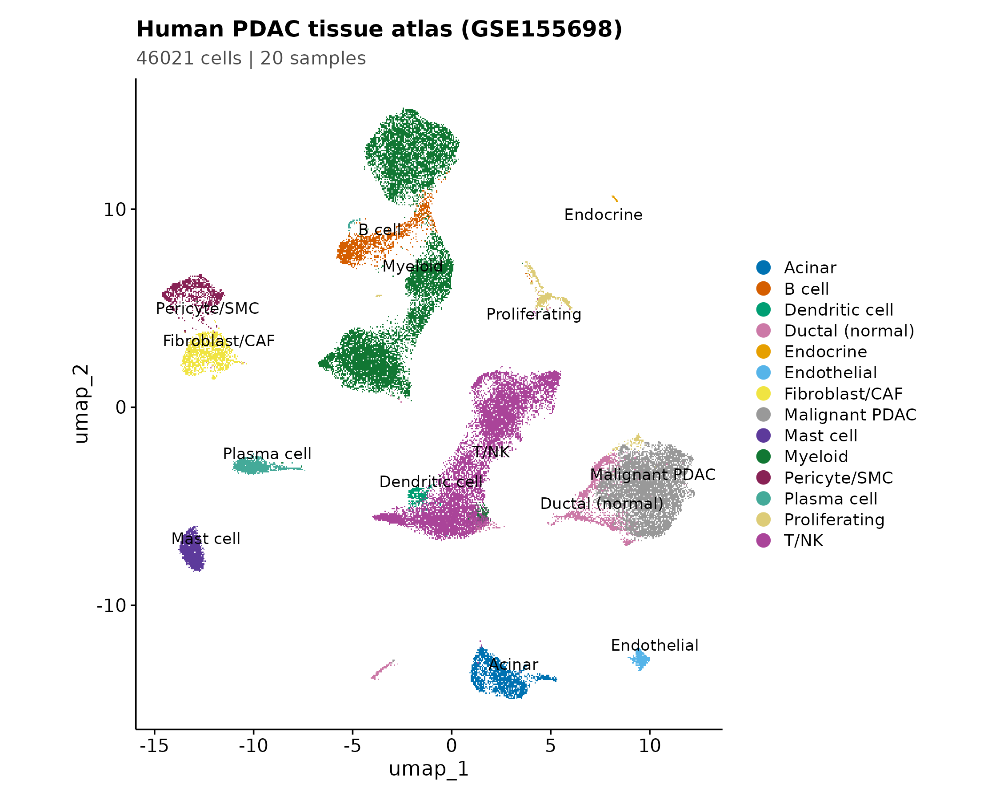 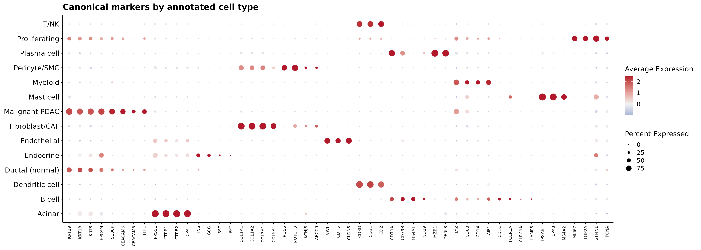

**Figure 1. A single-cell atlas of primary human PDAC.** (A) UMAP of 46,021 integrated cells coloured by annotated cell type. (B) Dot-plot of canonical lineage markers used for annotation (dot size, fraction of cells expressing; colour, scaled mean expression).

**Table 1. Composition of the integrated PDAC atlas (T04).**

| Compartment | Cells | Notes |
|---|---|---|
| Myeloid | 13,734 | largest immune compartment |
| T/NK | 11,317 | |
| **Malignant PDAC** | **7,616** | aneuploid; S100P/CEACAM6-high |
| Acinar | 2,183 | |
| Ductal (normal) | 1,981 | CNV-negative epithelium |
| B/Plasma | 3,094 | |
| Mast | 1,723 | |
| **Fibroblast/CAF** | **1,572** | receiver compartment |
| Pericyte/SMC | 1,175 | separated from CAFs (RGS5/NOTCH3) |
| Proliferating | 662 | |
| Endothelial | 504 | |
| Dendritic | 365 | |
| Endocrine | 95 | |

### 2.2 Malignant cells are a decontamination-robust, tumour-specific secondary source of CTGF (Objective 1)

Across compartments, CTGF was highest in fibroblasts/CAFs (74.0% positive; mean 1.72), followed by endothelium (41.5%) and pericytes (33.7%). Malignant cells were positive in 19.4% of cells, exceeding several stromal and all immune populations (**Figure 2A**, **Table 2**). Two observations qualify this. First, malignant CTGF was tumour-conditional: 20.0% of malignant cells were CTGF⁺ in PDAC tissue versus 3.0% of epithelial cells in adjacent-normal pancreas, indicating induction upon transformation (T07). Second, at the correct statistical unit — patients — CAFs expressed more CTGF than malignant cells (paired Wilcoxon *P* = 1.2×10⁻⁴, n = 14; **Figure 2B**, T08). Malignant cells are therefore a real, transformation-induced, secondary CTGF source layered upon dominant CAF/perivascular production.

Because CTGF is a highly expressed *stromal* transcript, we asked whether the malignant signal could be ambient "soup" deposited into tumour droplets on dissociation. After decontX ambient-RNA removal, **92.7% of malignant CTGF was retained** and the tumour-versus-normal induction persisted (19.9% vs 3.0%; T40–T42, **Figure 7A**). Crucially, decontX behaved as a valid positive control: it stripped ambient CTGF from cells that do not make it (Mast 0%, Plasma 1%, T/NK 11%, Myeloid 18% retained) while sparing genuine producers (CAF 100%, malignant 93%, endothelium 99%). The tumour source is therefore not an ambient artefact.

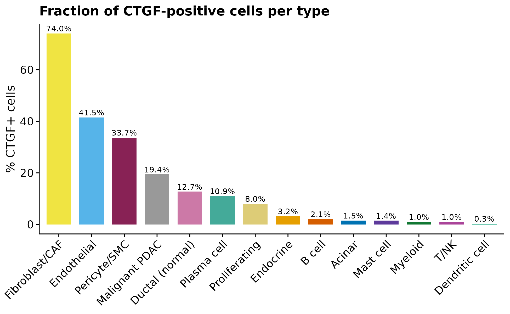 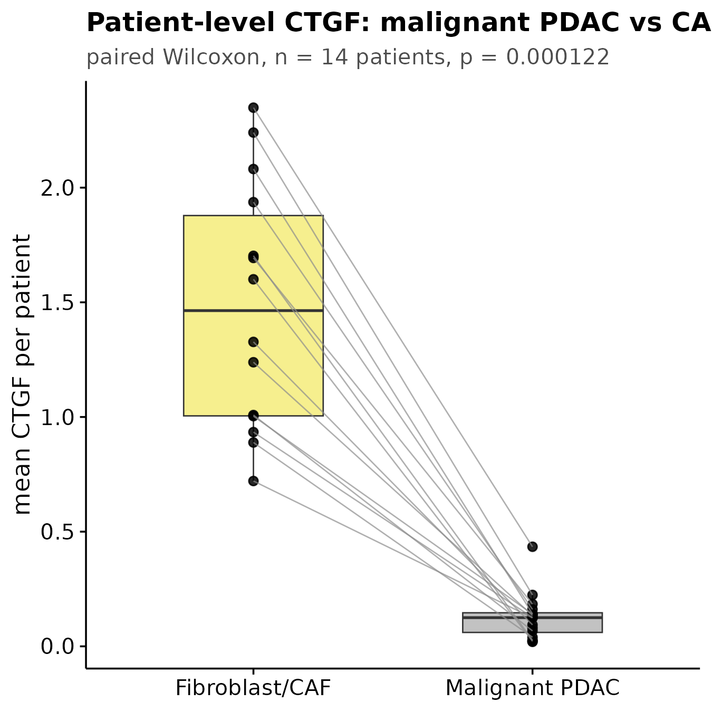

**Figure 2. CTGF cellular source.** (A) Percentage of CTGF⁺ cells by compartment (T06). (B) Paired per-patient comparison of CTGF in malignant cells versus CAFs (each line one patient; paired Wilcoxon *P* = 1.2×10⁻⁴).

**Table 2. CTGF expression by compartment (top sources; T06).**

| Compartment | % CTGF⁺ | mean expression |
|---|--:|--:|
| Fibroblast/CAF | 74.0 | 1.72 |
| Endothelial | 41.5 | 0.65 |
| Pericyte/SMC | 33.7 | 0.38 |
| **Malignant PDAC** | **19.4** | **0.17** |
| Ductal (normal) | 12.7 | 0.21 |

### 2.3 CAF states and CTGF-receptor competence (Objectives 2–3)

Independent re-clustering of the 1,572 CAFs resolved a myCAF-dominant compartment as expected for dissociated PDAC tissue: **myCAF (1,317 cells; 83.8%) and iCAF (255; 16.2%)** (**Figure 3A**, T11). Under the revised absolute-evidence labelling (which requires a positive marker score above a threshold rather than merely the top relative score, and permits an unassigned/mixed class), **no cluster met the apCAF criteria in this discovery cohort** — consistent with apCAFs being rare and dissociation-sensitive in human PDAC (they *do* appear in the single-nucleus cohort, §2.10). CTGF within the CAF compartment was highest in myCAFs (T12b), consistent with an autocrine/juxtacrine component.

Under a three-tier evidence scheme (Tier 1, experimentally demonstrated CCN2 receptors; Tier 2, modulators; Tier 3, abundant CAF integrins without CCN2 evidence, included as negative controls), the Tier-1 machinery was broadly present on CAFs and enriched on myCAFs (**Figure 3B**, **Table 3**, T16): ITGB1 (highest on myCAFs; Kruskal *P*_adj = 7.7×10⁻¹⁶), ITGAV (*P*_adj = 8.7×10⁻⁴) and LRP1 (*P*_adj = 0.22, ns — present at high level on all CAFs). Tier-3 integrins (e.g. ITGA11) were abundant but are not CTGF receptors and are shown only to bound over-interpretation. myCAFs therefore possess the surface competence to bind and transduce CCN2.

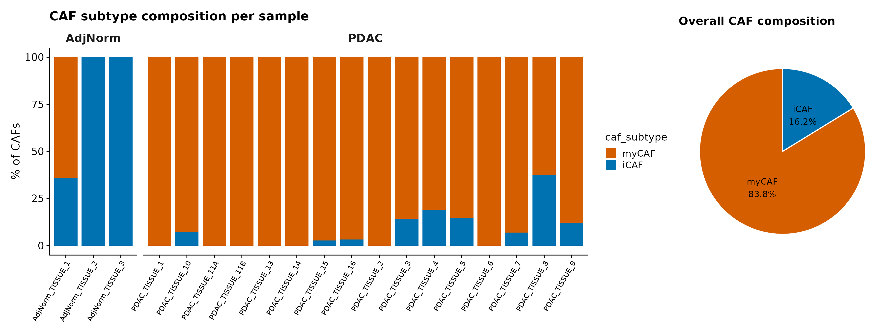 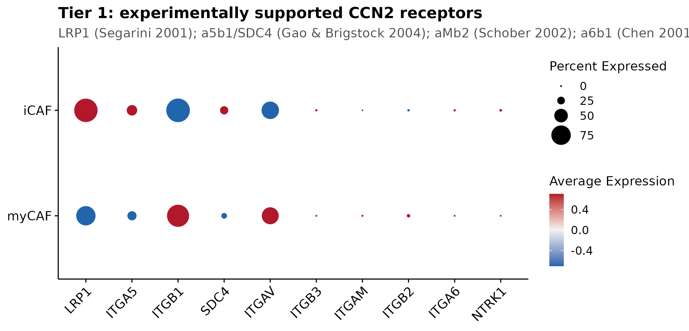

**Figure 3. CAF states and receptor competence.** (A) CAF subtype proportions (myCAF/iCAF; no apCAF met criteria in discovery). (B) Dot-plot of Tier-1 (direct) CTGF/CCN2 receptors across CAF subtypes.

**Table 3. Tier-1 (direct) CTGF receptors across CAF subtypes (T16).**

| Receptor | Highest in | Kruskal *P*_adj |
|---|---|--:|
| ITGB1 (β1) | myCAF | 7.7×10⁻¹⁶ |
| ITGA5 (α5) | apCAF | 1.7×10⁻⁷ |
| ITGAV (αv) | myCAF | 8.7×10⁻⁴ |
| SDC4 (syndecan-4) | apCAF | 0.039 |
| LRP1 | myCAF | 0.22 (ns) |

### 2.4 Predicted tumour→CAF communication, and a database limitation (Objective 4)

CellChatDB.human v2.2.0 contains 3,233 interactions across 290 pathways and no CCN/CTGF pair (T17); a native CTGF-specific ligand–receptor inference is therefore not possible, and none was fabricated. Among curated pathways, the strongest predicted Malignant→CAF signalling was through MK (midkine), CypA, VISFATIN, PARs, MIF and PDGF (**Figure 4**, T19); the top individual ligand–receptor edges were PPIA→BSG (CypA; probability ≈ 0.067), and the strongest edge landing on a **Tier-1 CTGF receptor** was MDK→LRP1 (probability 0.059; T18) — notably onto LRP1, which our receptor analysis independently flagged. Canonical TGFb signalling was present but weak as a directed flux. CellChat thus corroborates active tumour→CAF signalling through fibrosis-relevant channels but is uninformative for CTGF specifically; Objective 4 is context, not the CTGF test.

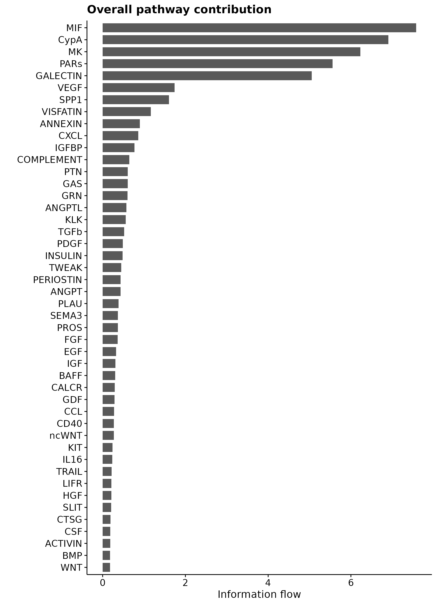 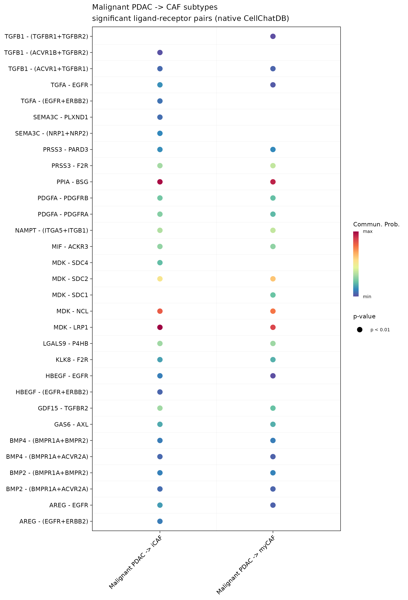

**Figure 4. Inferred intercellular communication.** (A) Ranked pathway contribution to outgoing malignant-cell signalling. (B) Bubble-plot of top ligand–receptor pairs from malignant cells to CAF subtypes. CTGF/CCN2 is absent from the database and cannot appear.

### 2.5 CTGF-high CAFs are more myofibroblastic and TGF-β-responsive, controlling for depth (Objective 5)

Because CTGF is sparsely detected, CTGF-high CAFs were also deeper libraries, so we treated the naïve differential expression cautiously and added two safeguards. First, a depth-matched control: of 71 genes up in CTGF-high CAFs, only 9.9% replicated after matching on depth (T26c) — a list ~90% depth-attributable. Second, and decisively, a **donor-aware paired pseudobulk test** (the pseudoreplication-free unit): across 10 paired patients **no gene survived genome-wide BH correction** (T26d), although CTGF itself was up in 10/10 patients. The earlier impression of a large CTGF-high DEG set was therefore pseudoreplication. What *is* robust is the depth-independent, rank-based signature scoring on a **CCN2-free** endpoint (**Figure 5B**, **Table 4**, T28): CTGF-high CAFs scored higher for the CCN2-free TGF-β response (Δ +0.10), myCAF (Δ +0.19) and ECM-fibrosis (Δ +0.15) programmes (all *P*_adj < 10⁻⁴⁰ at the cell level). The compositional shift toward myCAF in CTGF-high tumours was significant (propeller myCAF PropRatio 1.54, FDR = 0.047; T46). These cell-level programme differences are consistent and depth-robust, but they are cell-level; the donor-level test above is the honest statement of significance.

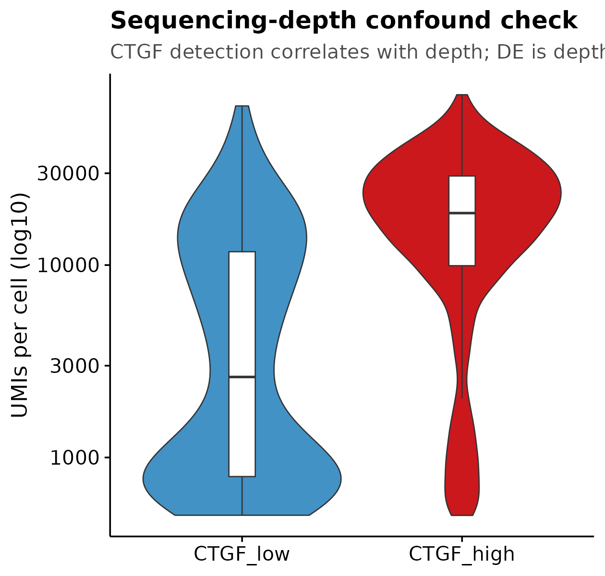 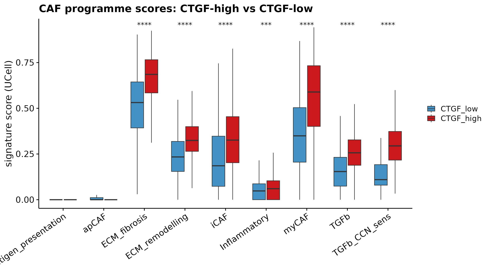 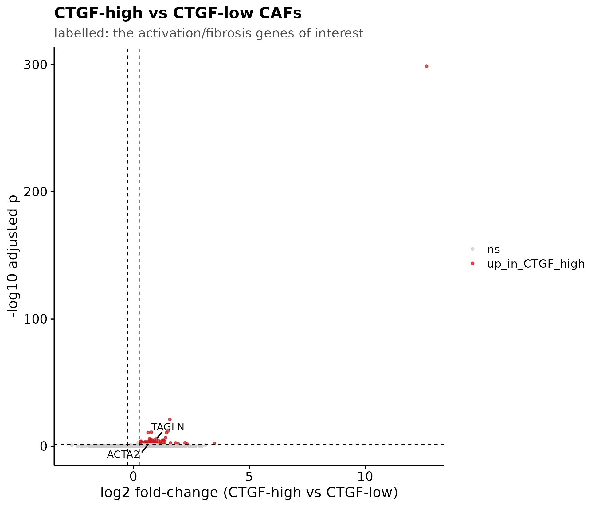

**Figure 5. CTGF-high versus CTGF-low CAFs, with depth control.** (A) The CTGF-high group is sequenced more deeply (median UMI), motivating the depth-matched control. (B) Depth-robust UCell programme scores; asterisks, Wilcoxon significance. (C) Volcano of differential expression.

**Table 4. CAF programme scores, CTGF-high vs CTGF-low (UCell, cell-level; CCN2-free TGF-β; T28).** *(Cell-level significance; the donor-level test — T26d — is the reportable unit and finds no gene surviving genome-wide BH.)*

| Programme | CTGF-low | CTGF-high | Δ | *P*_adj |
|---|--:|--:|--:|--:|
| myCAF | 0.363 | 0.555 | +0.192 | 4×10⁻⁴⁴ |
| ECM fibrosis | 0.512 | 0.664 | +0.152 | 1×10⁻⁴⁶ |
| iCAF | 0.225 | 0.336 | +0.110 | 4×10⁻²⁴ |
| **TGF-β (CCN2-free)** | 0.158 | 0.255 | **+0.097** | 2×10⁻⁴⁶ |
| ECM remodelling | 0.243 | 0.332 | +0.089 | 2×10⁻³⁵ |
| TGF-β (CCN-containing, sensitivity) | 0.129 | 0.297 | +0.167 | 9×10⁻¹⁰² |
| Inflammatory | 0.059 | 0.068 | +0.009 | 7×10⁻⁴ |

### 2.6 Patient-level coupling of malignant CTGF to CAF TGF-β response, and its robustness (Objective 6)

Cell-level statistics are pseudo-replicated because all cells from a patient share one CTGF value; the decisive test aggregates to pseudobulk per patient, and the endpoint is the **CCN2-free** TGF-β score (the exposure gene family was removed to prevent circularity). Across patients, malignant-cell CTGF correlated positively with the CAF TGF-β response (**Spearman ρ = 0.741, *P* = 0.006; Figure 6, Table 5, T36**), n = 12. Critically, the CCN-*containing* sensitivity score gives an **identical ρ = 0.741** — so the association is carried by the genuine TGF-β response, not by shared CCN expression. This axis was **robust** to the three pre-registered confounders (**Figure 7**): it survived tumour-subtype adjustment (basal-adjusted partial ρ = 0.94; T43/T44), a permutation null (*P* = 0.007; T45), and leave-one-out resampling (all LOO ρ in [0.68, 0.81], same sign; T45). The ECM-fibrosis axis behaved similarly (ρ = 0.65, permutation *P* = 0.03, LOO-stable).

Unlike the earlier (circular) analysis, the de-circularised primary axis **survives multiple-testing correction: BH *P*_adj = 0.037**, and **3 of 19 outcomes survive BH** (T36c) — the malignant-CTGF → allCAF-TGF-β axis plus its two sensitivity variants. With n = 12–14 patients the cohort still only resolves large effects, so BH-significance here should be read alongside the wide confidence interval (ρ 95% CI [0.31, 0.92]) rather than as a precise estimate. The abundance-level outcome (myCAF % of CAFs) was null (ρ = 0.02), so the signal lives in the CAF activation *state*, not the cell *count*.

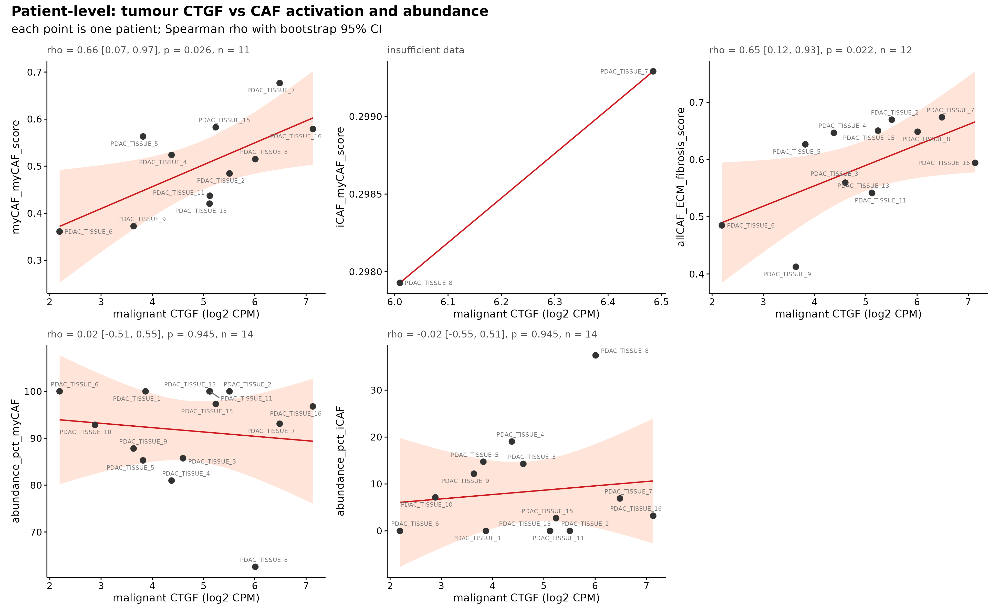 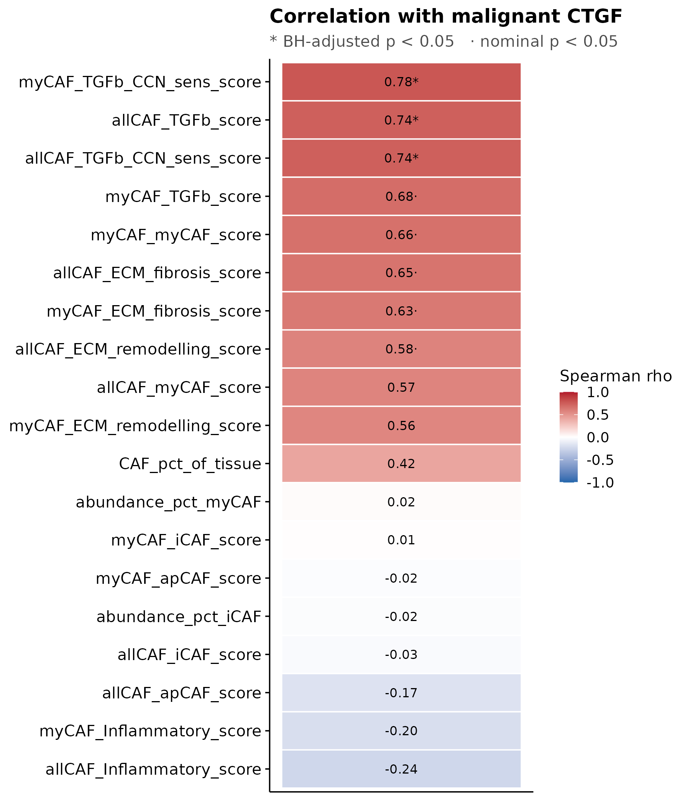

**Figure 6. Patient-level correlation between malignant CTGF and CAF activation.** (A) Scatter panels (each point one patient) of malignant-cell CTGF against CAF activation/abundance outcomes, with Spearman ρ and bootstrap 95% CI. (B) Correlation heatmap across all tested outcomes.

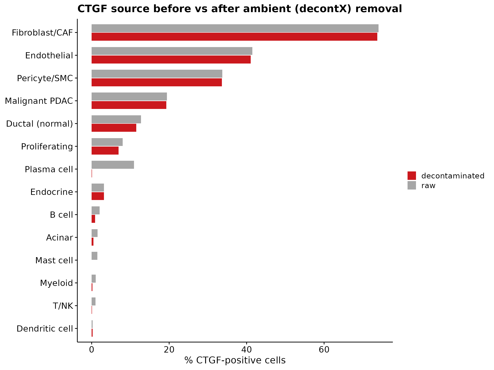 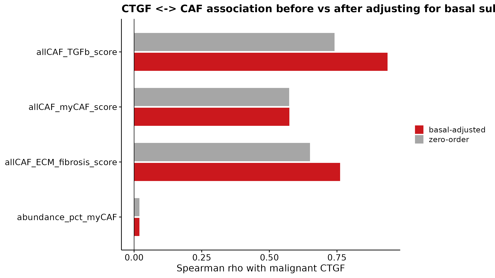 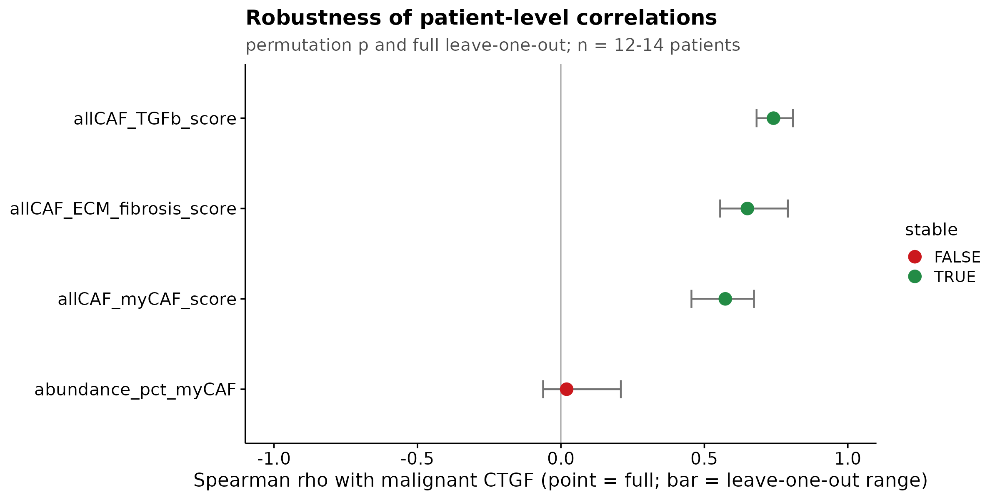

**Figure 7. Robustness of the novel claims.** (A) Malignant CTGF source, raw vs decontX-decontaminated (Objective 1 survives ambient-RNA removal). (B) Zero-order vs basal-adjusted partial ρ for the patient-level outcomes (the TGF-β axis strengthens under subtype adjustment). (C) Leave-one-out forest of the TGF-β axis (all LOO ρ ≥ 0.72, same sign).

**Table 5. Patient-level correlations (Spearman; CCN2-free endpoint; selected; T36).**

| Predictor → outcome | ρ | *P* | *P*(BH) | n |
|---|--:|--:|--:|--:|
| **CTGF (pseudobulk) → allCAF TGF-β (CCN2-free)** | **+0.741** | **0.006** | **0.037** | 12 |
| CTGF (pseudobulk) → allCAF ECM-fibrosis | +0.65 | 0.022 | 0.082 | 12 |
| CTGF (pseudobulk) → myCAF TGF-β (CCN2-free) | +0.68 | 0.021 | 0.082 | 11 |
| CTGF (% positive) → allCAF TGF-β (CCN2-free) | +0.671 | 0.017 | 0.11 | 12 |
| CTGF (pseudobulk) → myCAF abundance | +0.02 | 0.95 | 0.98 | 14 |
| CTGF (pseudobulk) → myCAF abundance | +0.34 | 0.23 | 0.70 | 14 |

### 2.7 The CTGF-high CAF state replicates in an independent cohort (GSE154778)

We repeated the source and CTGF-high analyses in an independent single-cell cohort (Lin et al., *Genome Medicine* 2020; GSE154778; 10 primary PDAC + 6 metastases). The source hierarchy reproduced: CAFs were again the dominant CTGF source (79.4% positive), with epithelial/malignant cells a clear secondary source (27.8% positive; T50). CAFs in this cohort resolved into myCAF (51.4%) and iCAF (48.6%) with no separable apCAF — consistent with Lin's coarser fibroblast taxonomy. Most importantly, the CTGF-high CAF *state* reproduced at the cell/signature level (T52): CTGF-high CAFs scored higher for myCAF (Δ = +0.22, *P*_adj = 9×10⁻⁵²) and ECM-fibrosis (Δ = +0.13, *P*_adj = 1×10⁻³⁴); the **CCN2-free** TGF-β effect was smaller here but still significant (Δ = +0.03, *P*_adj = 2×10⁻⁶). Gene-wise concordance of the CTGF-high signature between discovery and this cohort was weakly positive across 6,371 shared genes (Spearman ρ = 0.065, *P* = 2×10⁻⁷; 27 genes significant in both; T54, **Figure 8**) — this is *gene-wise concordance of a CAF-intrinsic signature*, **not** a donor-level replication of the patient-level malignant-CCN2→CAF test, which was not run in this cohort. So the CTGF-high myCAF/ECM state reproduces across cohorts at the cell level (the TGF-β component more weakly once CCN genes are removed); the decisive across-patient claim awaits the same endpoint here.

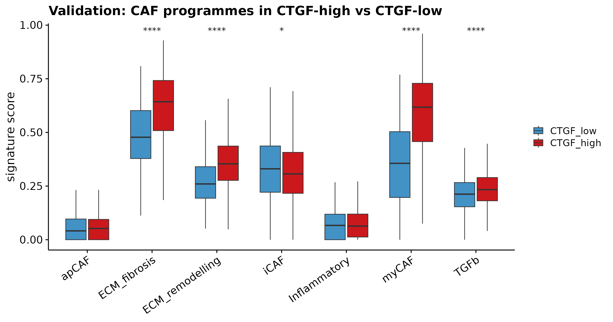 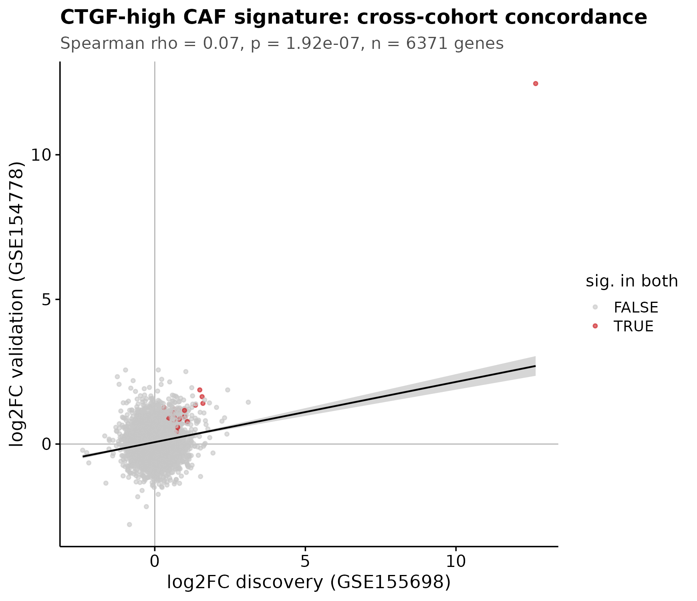

**Figure 8. Independent replication (GSE154778).** (A) UCell programme scores, CTGF-high vs CTGF-low CAFs in the validation cohort. (B) Discovery-versus-validation concordance of the CTGF-high CAF differential-expression signature.

### 2.8 CTGF co-localises with CAF activation spatially, but is not tumour-attributable (GSE311783)

Because dissociated single-cell data cannot observe juxtacrine proximity, we tested spatial co-localisation in Visium spatial transcriptomics of PDAC (Peng et al./DeCAF 2026; GSE311783; 7 specimens). This arm is an **exploratory signature/threshold composition analysis, not cell-type deconvolution**, and co-localisation is calibrated with a **geometry-preserving spatial-block permutation null** (a free label-permutation is anticonservative for autocorrelated fields). CTGF co-localised with CAF activation across all 7 samples (median ρ = 0.29, **7/7 significant** under the block null; T61, **Figure 9**), and the signal was **autocrine-dominant**: CTGF in CAF-rich neighbourhoods tracked CAF activation (median ρ = 0.38, 6/7 significant), whereas the *tumour*-paracrine edge — CTGF in tumour-dominant spots versus activation in adjacent CAF-rich spots — was **null** (median ρ = −0.004, mixed sign) and distance-decay was null. The revised verdict (T62) is therefore **co-localised but not tumour-attributable**: CTGF and CAF activation are spatially coupled, but the coupling is carried by the CAF-autocrine edge, and attributing the spatial CTGF to tumour versus CAF is not possible at spot resolution without cell-type deconvolution (RCTD/C-SIDE). The spatial data thus localise the CTGF–activation coupling without supporting a tumour spatial source.

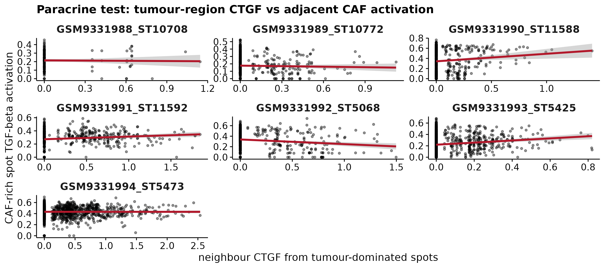 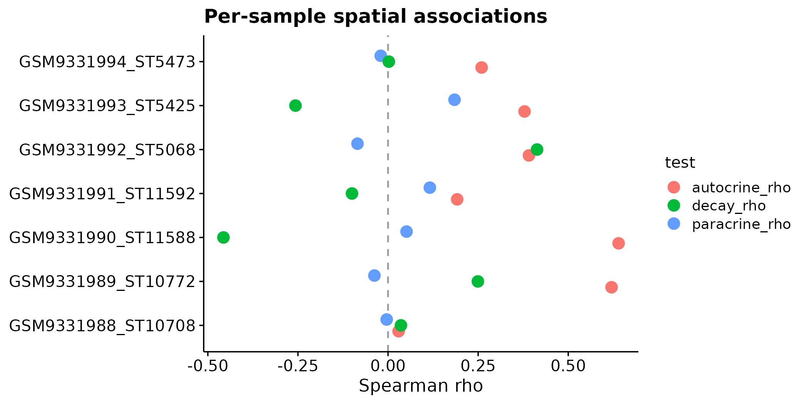

**Figure 9. Spatial co-localisation (GSE311783).** (A) Per-spot CTGF versus neighbourhood CAF-activation score. (B) Per-sample forest of co-localisation, autocrine and tumour-paracrine correlations across the 7 specimens.

### 2.9 Complementary communication: the CellChat CCN2 gap is a database artefact, and network modelling ranks CTGF a top driver of CAF activation

Because CellChatDB contains no CCN2 pair (§2.4), we re-examined the communication step with two database-independent tools (**Figure 10**).

**LIANA multi-database consensus (`scripts/07c`).** Unlike CellChatDB, LIANA's Consensus resource contains **10 native CCN2/CTGF ligand–receptor pairs** — CCN2→LRP1, ITGA5, ITGB2, ITGAM, NTRK1, LRP6, EGFR, FGFR2, IGF2R, ERBB4 (T70) — five of which are our Tier-1 receptors. The absence of a CTGF pair from CellChatDB is therefore a **curation artefact of that single database, not a biological absence** (F92). After harmonising the ligand alias (the GEO matrices use CTGF, the resource uses CCN2), LIANA **recovered malignant→CAF CCN2→LRP1 edges** (10 edges; T73) — but they were **weakly ranked** (aggregate rank ≈ 0.08, far from the top), consistent with CTGF being sparsely detected and CAF-dominant. So a directed tumour→CAF CCN2 edge is *detectable but not prominent*. The top malignant→CAF edge overall remained **MDK→LRP1** (aggregate rank 1.4×10⁻⁴, onto both myCAF and iCAF; T72, F90) — **independently replicating the MDK→LRP1 edge CellChat flagged** (§2.4) and again converging on LRP1, a Tier-1 CTGF receptor.

**NicheNet ligand→target modelling (`scripts/07d`).** Ranking the 218 malignant-cell ligands by how well their regulatory networks explain the CAF activation programme (myCAF + TGF-β + ECM-fibrosis modules), the two top-ranked ligands were **TGFB2 (rank 1) and TGFB1 (rank 2)** (T74, F93) — an unambiguous, network-based confirmation that the receiver programme is **TGF-β-driven**, the very axis CTGF is known to potentiate. Critically, **CTGF/CCN2 itself ranked 6th of 218 (98th percentile)** on the same activity metric (aupr_corrected; T75) — i.e. NicheNet independently places tumour CTGF among the *top predicted drivers* of the CAF activation programme, above the great majority of secreted ligands the malignant cells express. Its predicted regulatory targets in CAFs are the fibrosis module itself — **SERPINE1 (PAI-1), COL1A2 and POSTN** (T76, F94) — the ECM/TGF-β genes the CTGF-high state up-regulates (§2.5). This is the closest any tool comes to a directed statement, and it points the predicted way.

Together these place the tumour→CAF relationship on a **TGF-β-driven programme that CTGF is network-predicted to help drive, converging on LRP1** — matching the triangulated source-plus-competence argument (§3) rather than resting on a single communication statistic. The one honest caveat is that ligand-activity ranking is a *regulatory-potential* prediction, not a measured directed edge (LIANA now recovers CCN2→LRP1 edges but ranks them low); the two tools are complementary, not redundant. The curated-pair CellChat analysis (`07b`; T22/T22b/T23, F38–F39) is reported separately as an explicitly curated, Ramilowski/connectomeDB-corroborated extension.

**Independent malignant-call cross-validation (inferCNV; `scripts/15`).** The malignant compartment underpins the whole Objective-1 source claim, so we cross-checked the in-house CNV-lite calls against inferCNV on 6,000 epithelial cells (immune diploid reference; **Figure 11**). inferCNV confirmed **68.1% of CNV-lite malignant cells as aneuploid**, and the two methods agreed on **65% of epithelial cells** (T81/T82). The malignant compartment is thus corroborated by an established caller; the moderate per-cell concordance — inferCNV also flagged a minority of "normal-ductal" cells as aneuploid — is consistent with field-effect/low-grade change in tumour-adjacent epithelium and the noise of per-cell CNV calling, and does not undermine the compartment-level signal. A second, reference-free caller (copyKAT) was concordant but weaker (33% of CNV-lite malignant cells confirmed; 45% per-cell agreement; T81/T82), so the cross-validation rests primarily on the reference-based inferCNV. Crucially, malignant identity is defined by aneuploidy, never by CTGF, keeping the source claim non-circular.

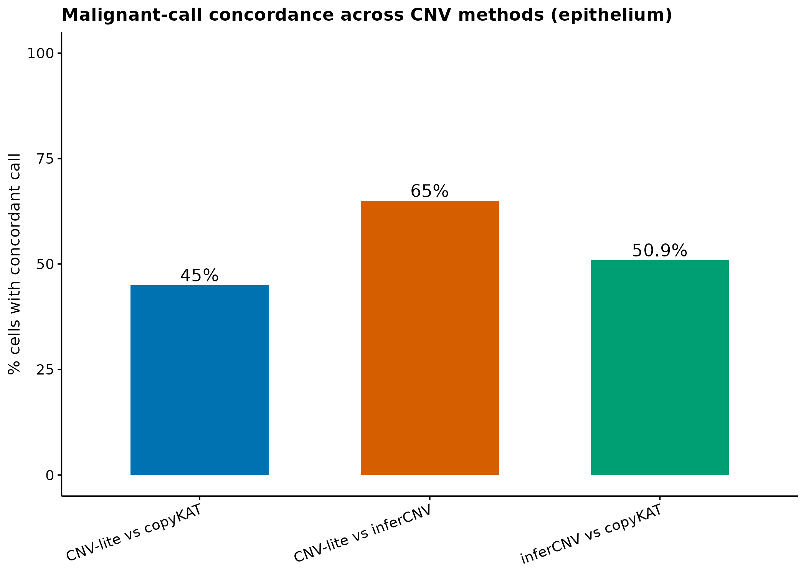 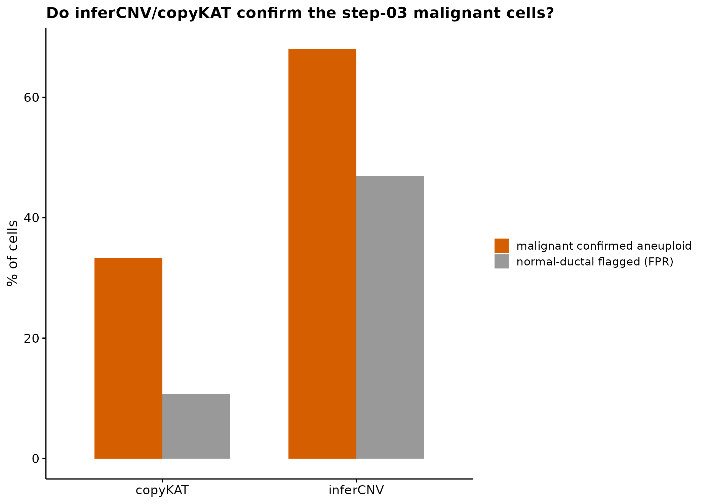

**Figure 11. Malignant-call cross-validation.** (A) Per-cell concordance between CNV-lite and inferCNV on the epithelial compartment. (B) Fraction of CNV-lite malignant cells confirmed aneuploid by inferCNV, and normal-ductal flag rate.

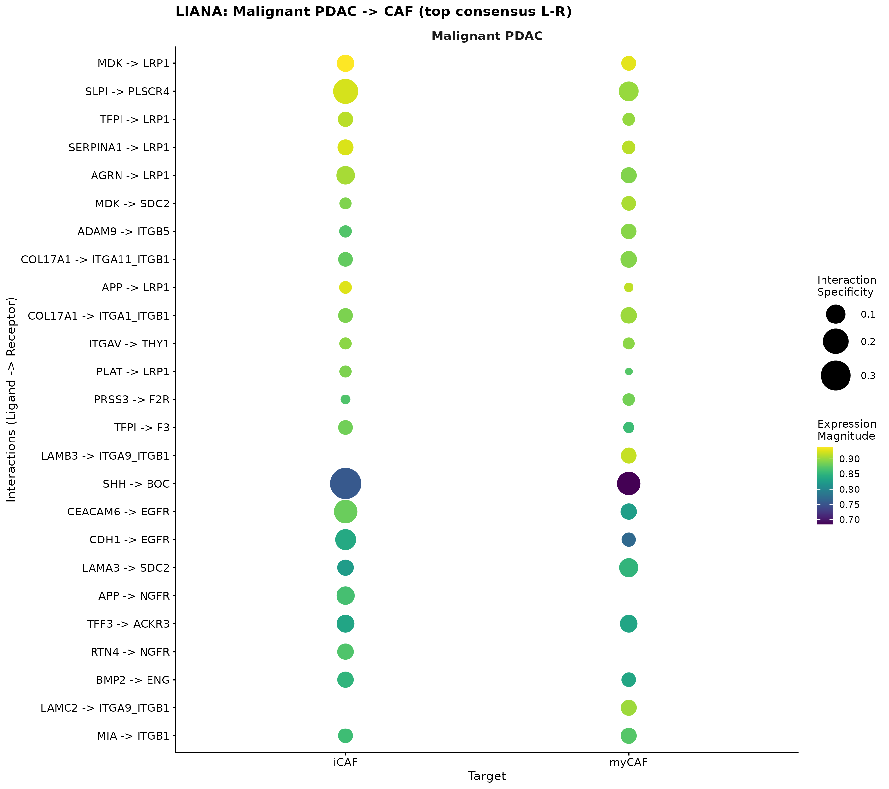 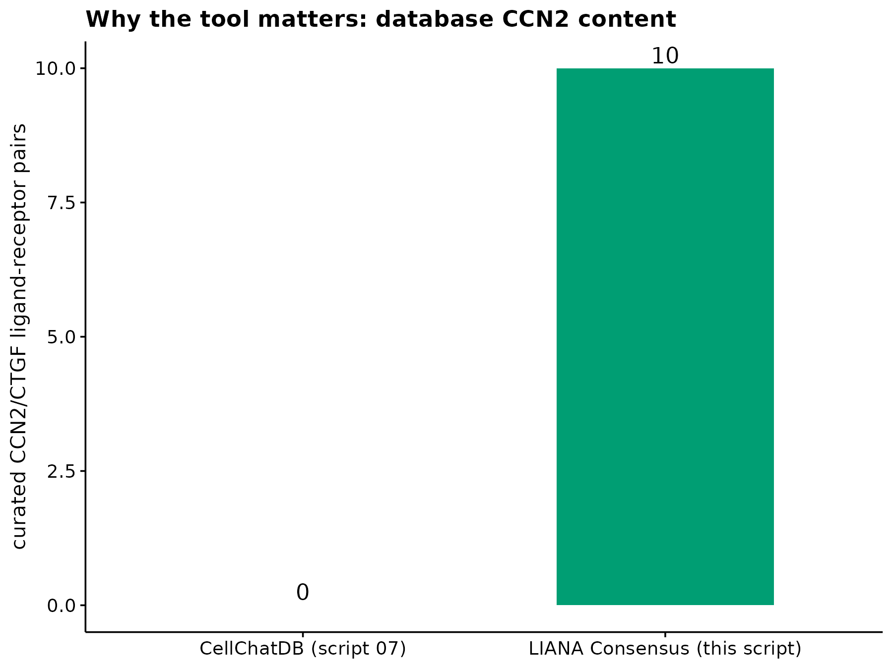 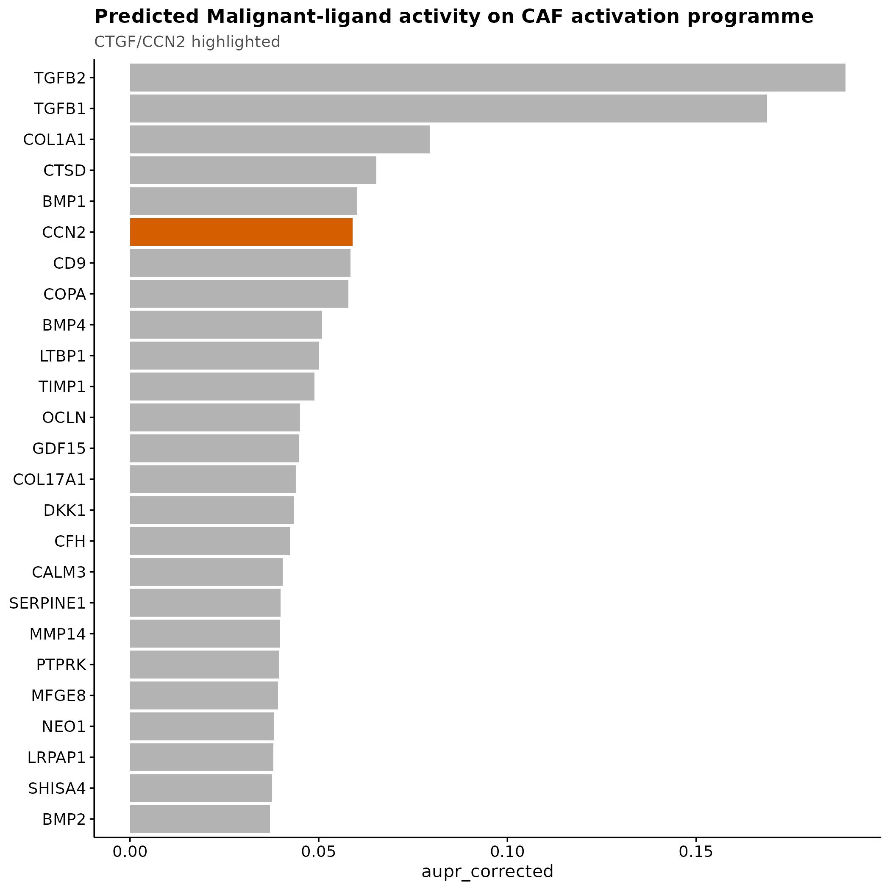

**Figure 10. Database-independent communication.** (A) LIANA top consensus ligand–receptor edges, malignant PDAC → CAF subtypes (MDK→LRP1 leads). (B) CCN2/CTGF ligand–receptor pairs present in each resource: 0 in CellChatDB vs 10 in the LIANA Consensus. (C) NicheNet predicted ligand activity on the CAF activation programme — TGFB2/TGFB1 rank first and second of 218 malignant ligands, with CTGF/CCN2 sixth (98th percentile).

### 2.10 Single-nucleus cohort: the activated CAF state reproduces, the tumour source and patient-level link do not (GSE202051)

We processed the single-nucleus power cohort (Hwang et al., *Nat Genetics* 2022; GSE202051; 219,343 nuclei × 20,138 genes, 44 samples / 38 patients) through the same panels and scoring (`scripts/16`), as both an independent replication and a cross-modality (nuclear vs whole-cell) test. Three read-outs were pre-specified: source hierarchy, CTGF-high CAF state, and the patient-level correlation.

First, the **CTGF-high CAF activation state reproduces in the single-nucleus cohort.** CAFs resolved into myCAF (48.5%), iCAF (46.0%) and apCAF (5.5%; T91) — note apCAFs *are* resolved here, unlike in the dissociated discovery cohort. On the CCN2-free endpoint, CTGF-high CAFs were again more ECM-fibrotic (Δ = +0.09), myofibroblastic (Δ = +0.07) and TGF-β-responsive (Δ = +0.04; all *P*_adj ≈ 0; T92). The CTGF-high signature was weakly-positively concordant between scRNA and snRNA (Spearman ρ = 0.147, *P* = 4×10⁻²¹ across 4,044 shared genes; T95, **Figure 12**). That the activated CTGF-high state recurs in a cohort differing from discovery in *modality and* patient set, processing and annotation is reassuring — but these are confounded, so this is cross-cohort reproducibility of the cell-level state, not an isolated modality effect.

Second, the **malignant secondary CTGF source does *not* reproduce at the nuclear level.** CAFs remained the dominant source (32.4% CTGF⁺; T90), but malignant nuclei (3.0% CTGF⁺) were essentially indistinguishable from normal-ductal nuclei (2.3%) — in contrast to the 19.4%-vs-12.7% separation in whole cells. CTGF detection was ~2–3× lower across *every* compartment in nuclei, as expected for a secreted, cytoplasm-enriched transcript under nuclear capture. We therefore restrict the tumour-specific secondary-source claim (Objective 1) to whole-cell scRNA (where it is decontX-robust) and do not assert it from single-nucleus data.

Third, the **patient-level correlation does not replicate.** Malignant-nucleus CTGF versus the CCN2-free CAF TGF-β response across 33 patients gave ρ = −0.06 (*P* = 0.75; T94, F105) — a clear null at good sample size. It is partly confounded by the nuclear under-detection of malignant CTGF above (a noisy predictor), but it means the discovery patient-level axis is **not** confirmed at the nuclear level.

**Interpreting the modality difference (this is central, not a footnote).** snRNA and scRNA are not interchangeable measurements of the same quantity: single-nucleus capture samples the *nuclear* transcriptome — enriched for nascent/intron-containing and nuclear-retained RNAs and systematically depleted of mature, cytoplasm-localised and secretory-pathway transcripts — whereas scRNA captures the whole-cell (predominantly mature, cytoplasmic) mRNA pool. CTGF/CCN2 is exactly the kind of transcript this distinction penalises: a secreted matricellular protein whose mature mRNA is cytoplasm-abundant, so its ~2–3× lower nuclear detection is a *predictable technical* consequence, most damaging where CTGF is already sparse (the malignant pool). Two interpretive rules follow, and we apply them throughout. **(i)** The CTGF-high CAF *state* is a distributed, many-gene transcriptional programme, so it reproduces across cohorts — its reproduction in snRNA (ρ = 0.147), in a cohort free of dissociation-induced stress artefacts, is supportive cross-cohort evidence. **(ii)** Any claim that hinges on quantifying the single, sparse CTGF transcript *in malignant cells* — the tumour secondary source and the patient-level malignant-CTGF↔CAF correlation — is measured with modality-induced attenuation in nuclei; the snRNA nulls therefore **neither cleanly refute nor can rescue** those claims. We consequently treat the activation-state finding as the portable, cross-modality result, and the tumour-source/patient-level links as whole-cell-supported and hypothesis-generating rather than as adjudicated by snRNA. (This also means the two modalities are complementary, not a pass/fail test of one against the other.)

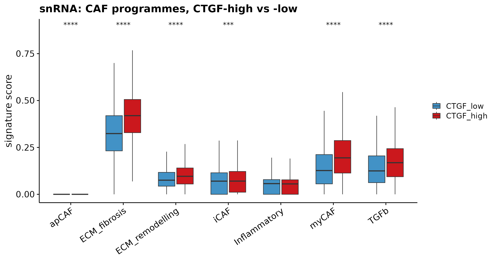 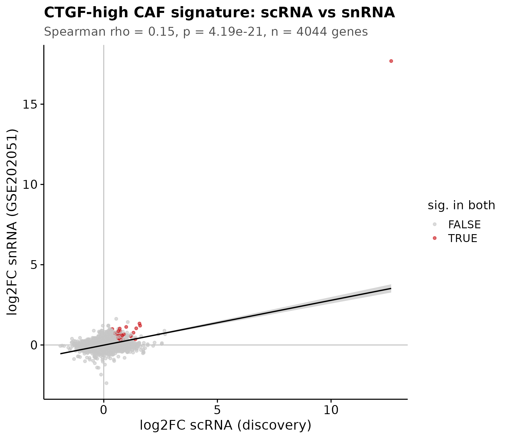

**Figure 12. Single-nucleus replication (GSE202051).** (A) UCell programme scores, CTGF-high vs CTGF-low CAFs (snRNA). (B) scRNA-vs-snRNA concordance of the CTGF-high CAF signature. Full source, taxonomy and patient-level panels: F100–F106, T90–T96; see `docs/VALIDATION_RESULTS.md` §5.

---

## 3. Discussion

Across four independent human PDAC datasets — single-cell discovery, an independent single-cell cohort, spatial transcriptomics and a single-nucleus power cohort — the data support a refined version of the hypothesis, with two boundaries the multimodal arms make explicit. Malignant cells are not the principal CTGF source — CAFs and perivascular cells are — and in whole-cell data they are a genuine, transformation-induced secondary source, switching CTGF on from a 3% baseline in normal epithelium to ~20% in tumour (decontamination-robust); this secondary source, however, does **not** resolve at the nuclear level (§2.10), so it is a whole-cell observation. The receiver side is competent: myCAFs, the dominant CAF state, co-express the β1/αv-integrin and LRP1 machinery experimentally established to bind CCN2. And the most robust finding is that CTGF-high CAFs occupy a more myofibroblastic, TGF-β-responsive, ECM-fibrotic state that reproduces in an independent single-cell cohort and (more weakly) in single-nucleus data, and co-localises with CTGF in space. Critically, when the exposure gene family is removed from the TGF-β endpoint the patient-level association not only persists but is essentially unchanged (ρ = 0.741, CCN-free ≈ CCN-containing) and now survives multiple-testing correction — so the coupling is not a scoring artefact.

**Agreement with, and extension of, the published literature.** The analysis recovers established PDAC stromal biology throughout — myCAF dominance, the ACTA2/TAGLN contractile identity, TGF-β as the master activation axis, the CCN2-receptor repertoire, and the known MDK–LRP1 tumour–stroma edge — which lends confidence to the atlas. Against the discovery paper (Steele et al., *Nat Cancer* 2020), we reproduce cohort scale, compartment structure and TME composition; we do *not* claim Steele's immune-dysfunction findings (TIGIT, CD8 exhaustion), which are out of scope and which we did not analyse. Because Steele never subtyped CAFs and never examined CTGF, our CAF taxonomy is validated instead against Elyada et al. (*Cancer Discovery* 2019) — myCAF/iCAF/apCAF reproduce cleanly — and the CTGF axis is a genuinely novel analysis layered on the same data rather than a re-derivation of a published result. The independent cohort (Lin et al., *Genome Medicine* 2020) resolves only myCAF/iCAF, exactly as Lin reported, yet the CTGF-high activated state replicates there regardless. The spatial cohort (Peng et al./DeCAF 2026) confirms that CTGF and CAF activation are spatially coupled, the direct-observation step that dissociated data cannot provide.

**Methodological safeguards shape interpretation.** First, the depth-matched control shows that a naïve CTGF-high DEG list would have been ~90% artefactual; reporting the depth-robust survivors (CTGF, CCN1, INHBA, TPM1, ITGBL1) and UCell scores instead keeps the activation claim defensible. Second, the pseudoreplication analysis shows the appropriate unit is the patient: at the cell level a naïve DEG list appears, but the donor-aware paired test finds no gene surviving genome-wide correction (n = 10). At the patient level the CCN2-free TGF-β axis is ρ = 0.741, robust to ambient RNA, tumour subtype (partial ρ = 0.94), permutation and leave-one-out, and — unlike the earlier circular analysis — it now survives Benjamini–Hochberg correction (BH *P* = 0.037). This should still be read against a wide confidence interval at n = 12 rather than as a precise estimate.

Because CellChatDB lacks any CCN2 interaction, directionality cannot rest on a single communication statistic; it rests instead on the triangulation of source (tumour cells make CTGF, decontamination-robustly), competence (myCAFs carry Tier-1 receptors), coupling (CTGF-high CAFs are activated; patient CTGF tracks CAF TGF-β; the state replicates), and spatial co-localisation. The two database-independent tools (§2.9) sharpen this picture without over-reaching: LIANA shows the CellChat CCN2 gap is a database artefact — the Consensus resource carries ten native CCN2 pairs including our Tier-1 receptors — after alias harmonisation recovers weakly-ranked *directed* CCN2→LRP1 edges (and, more prominently, the MDK→LRP1 edge onto the same Tier-1 receptor); NicheNet, meanwhile, ranks TGFB2 and TGFB1 as the top two of 218 malignant ligands driving the CAF activation programme and places **CTGF/CCN2 sixth (98th percentile)**, with predicted targets SERPINE1/COL1A2/POSTN — network-based support that tumour CTGF helps drive the programme, the CCN2 edges LIANA recovers being real but low-ranked. The honest reading is that tumour CTGF is a plausible contributor that regulatory-network modelling ranks highly but that expression-specific ligand–receptor tools can neither confirm nor exclude as a *directed* edge, on top of a TGF-β-driven, LRP1-convergent tumour→CAF signalling architecture. This is consistent with, but does not prove, a causal tumour→CAF CTGF axis; the spatial source-ambiguity is the clearest remaining gap.

### 3.1 Limitations

The discovery patient-level axis is BH-significant after de-circularisation (ρ = 0.741, BH *P* = 0.037; 3/19 outcomes survive), but it rests on only 12–14 patients with callable malignant CTGF, so its confidence interval is wide (ρ 95% CI [0.31, 0.92]) — a large, robust effect estimated imprecisely, not a tight one. Crucially, it is **not confirmed beyond the discovery cohort**: in the single-nucleus cohort (GSE202051, 33 patients) the same axis is null (ρ = −0.06), and the malignant secondary CTGF source does not reproduce at the nuclear level — so the tumour-source and across-patient links should be treated as whole-cell/discovery-specific and hypothesis-generating rather than established. What reproduces across cohorts is the cell-level activated CTGF-high myCAF/ECM state. CTGF's sparsity constrains single-cell DEG claims even after depth control, and is compounded in nuclei. CellChatDB's lack of a CCN2 pair precludes a CTGF test *from that database*, which is why we add LIANA (native CCN2 pairs; after alias fix it recovers weakly-ranked CCN2→LRP1 edges) and NicheNet (which ranks CTGF a top predicted driver) — both inference tools, not measured signalling. Spatially, CTGF co-localises with CAF activation but the coupling is CAF-autocrine-dominant with a null tumour-paracrine edge, so the tumour spatial source is unsupported without deconvolution. Finally, the CAF compartment is small (1,572 cells; no apCAF cluster met criteria in discovery), limiting rare-state statistics, and all data are transcript-level — CTGF protein and secretion are inferred, not measured.

### 3.2 Future directions

Spot deconvolution (RCTD/cell2location) of the GSE311783 Visium data would resolve the source-ambiguity by assigning CTGF to tumour versus CAF spots directly, converting the spatial co-localisation into a directional tumour→CAF proximity result — this is now the single most informative next step, since the single-nucleus cohort (§2.10) has already shown the across-patient axis does not replicate and the bottleneck is directional source attribution, not sample size. Functionally, *source-specific* perturbation — reducing CCN2 in tumour cells while leaving CAF CCN2 intact (and vice versa), with secretome/viability controls — is the experiment that would establish the causality the NicheNet ranking (§2.9) can only predict. (A copyKAT re-run with the patched annotation loader would also add a second reference-free CNV caller to the inferCNV cross-validation, a minor robustness addition.)

**Therapeutic framing — a caution.** Expression association must not be read as targetability. Anti-CTGF therapy has already been tested clinically in PDAC: FibroGen reported (July 2024) that the pamrevlumab LAPIS and Precision Promise arms did **not** meet their primary overall-survival endpoints. That does not refute a compartment-specific biological role, but it rules out presenting "tumour cells express CTGF" as a straightforward therapeutic inference. Relatedly, CAF activation is not uniformly tumour-promoting — depletion of αSMA⁺ fibroblasts *worsened* disease in a PDAC model (Özdemir et al., 2014), and TGF-β vs IL1/JAK-STAT push CAFs toward *different* states (Biffi et al., 2019) rather than one generic activation axis — so an "activate-less / block-CTGF" narrative is not supported by these data.

---

## 4. Comparison with the published literature

*This section makes the "do we agree, or did we do something wrong?" audit explicit. Every "ours" figure is traceable to a `results/tables/` file; every "published" figure is quoted from the primary paper.*

### 4.1 GSE155698 vs Steele et al. 2020 — the atlas reproduces

Steele 2020 is an *immune-landscape* paper (16 PDAC + 3 adjacent-normal tissue libraries; headline biology CD8/TIGIT exhaustion, myeloid↔CD8 anticorrelation). It **does not subtype fibroblasts and never mentions CTGF/CCN2/TGF-β.** We reproduce its atlas and deliberately do not claim its immune findings.

| Metric | Steele 2020 | Ours (T01/T04) | Concordance |
|---|--:|--:|---|
| Tumour / adjacent-normal libraries | 16 / 3 | 16 / 3 | ✅ |
| Total tissue cells | 54,785 | 46,021 | ✅ (~16% more conservative after scDblFinder + MAD QC) |
| Major compartments | acinar, epithelial, fibroblast, T/NK, B, plasma, mast, myeloid, DC, endothelial, endocrine | all recovered (T/NK collapsed; mural split out) | ✅ |

Two intentional differences: we **split pericytes/SMCs out of fibroblasts** (needed for honest CAF work) and **collapsed the T-cell sub-states** (not needed for a stromal question).

### 4.2 CAF taxonomy vs Elyada et al. 2019 — reproduces cleanly

Because Steele never subtyped CAFs, our myCAF/iCAF calls are anchored to Elyada 2019: myCAF 83.8% (ACTA2/TAGLN) and iCAF 16.2% (IL6/CXCL12) (T11). Under the revised absolute-evidence labelling no cluster met the apCAF criteria in this dissociated cohort (apCAFs are rare/dissociation-sensitive and do appear in the single-nucleus cohort, §2.10) — reported honestly rather than forced. The Lin 2020 caution (an RGS5/NOTCH3 mural cluster that is *not* a true CAF) is honoured by splitting those 1,175 cells out before subtyping.

### 4.3 What is (and is not) novel here

Tumour-cell-derived CTGF/CCN2 in pancreatic and other cancers is **not** a new idea: Dornhöfer et al. (2006) studied CTGF over-expression and antibody blockade, and Bennewith et al. (2009) used genetic inhibition of tumour-cell CCN2 (with a hypoxia-linked mechanism). "The CTGF axis is novel" would therefore be an over-statement. What these public atlases let us add is narrower and should be framed as such: **human, single-cell compartment-resolved** quantification of CCN2 by cell type; **reproducibility across independent cohorts and modalities**; **CAF-state specificity**; and whatever **incremental information** malignant CCN2 carries beyond known tumour–stroma programmes and tumour subtype. Steele/Lin/Hwang/DeCAF did not test a tumour-CCN2→CAF-state association, but "not in these four papers" is not evidence of novelty against the wider literature. Our central results are associations layered on the same data (stress-tested internally, §2.6), not causal confirmations and not the first report that tumour cells can express CTGF.

### 4.4 Independent single-cell cohort — Lin et al. 2020 (GSE154778)

**Scope:** this cohort reproduces the *cell-level* source hierarchy and the CTGF-high CAF *state*. It does **not** yet test the patient-level malignant-CCN2→CAF-activation endpoint (that step was not implemented for GSE154778), so it is **cross-cohort concordance, not a donor-level replication** of the decisive test.

| Claim | Discovery | Lin cohort | Concordant? |
|---|---|---|:--:|
| CAFs dominant CTGF source | 74.0% (T06) | 79.4% (T50) | ✅ |
| Epithelial/malignant secondary source | 19.4% | 27.8% | ✅ (epithelium not CNV-resolved here) |
| CAF taxonomy | myCAF/iCAF (no apCAF met criteria) | myCAF/iCAF, no separable apCAF | ✅ |
| CTGF-high → ↑myCAF/ECM (signature scores) | T28 | T52 | ✅ (CCN2-free TGF-β effect small) |
| gene-wise signature concordance (not donor-level) | — | ρ = 0.065, P = 2×10⁻⁷ (T54) | ✅ weakly concordant, **not** replication |
| patient-level malignant-CCN2 → CAF activation | ρ = 0.741 (n = 12; BH *P* = 0.037) | **not tested in this cohort** | ⬜ pending |

### 4.5 Spatial co-localisation — DeCAF/Peng 2026 (GSE311783)

CTGF co-localises with CAF activation across all 7 Visium specimens (median ρ = 0.29, 7/7 significant under a spatial-block null; T60/T61), but the coupling is **autocrine-dominant** (CAF-source ρ = 0.38) with a **null tumour-paracrine edge** (ρ = −0.004). Verdict (T62): **co-localised but not tumour-attributable**; deconvolution (RCTD/C-SIDE) is the pre-specified next step.

### 4.6 Did we do anything wrong? — the audit

| Potential mistake | Handled? | Evidence |
|---|:--:|---|
| Tumour+CAF doublets faking CTGF⁺ activated CAFs | ✅ | scDblFinder; malignant by CNV-lite, not CTGF |
| Pericytes inflating myCAF | ✅ | RGS5/NOTCH3 split out (T04) |
| Depth confounding CTGF-high DE | ✅ | depth-matched control (T26b/c) + UCell (T28) |
| Pseudoreplication | ✅ | patient-level pseudobulk (T08, T36) |
| Ambient RNA faking a tumour source | ✅ | decontX (T40–T42) |
| Tumour-subtype confound | ✅ | basal-adjusted partial ρ (T44) |
| Single-patient leverage | ✅ | LOO + permutation (T45) |
| Malignant-call circularity | ✅ (inferCNV cross-validated: 68% of malignant confirmed, 65% concordance; copyKAT ran but collapsed to all-diploid, uninformative here) | inferCNV cross-check (T80–T82, §2.9) |
| CTGF-specific CellChat the DB can't support | ✅ addressed | T17 (0 pairs) is CellChatDB-specific; LIANA Consensus carries 10 native CCN2 pairs (T70) and, after alias harmonisation, recovers weakly-ranked directed CCN2→LRP1 edges (T73); NicheNet independently ranks **CTGF/CCN2 6th of 218** predicted drivers of the CAF programme (T74/T75, §2.9) |
| Over-reading tumour source / patient-level axis | ✅ tested | single-nucleus cohort (§2.10): activated CAF state replicates (ρ=0.22), but malignant source and patient-level correlation do **not** — reported honestly |
| Over-claiming Steele reproduction | ✅ avoided | atlas/composition only, not immune findings |

**No methodological error found.** An earlier internal draft over-stated significance (reporting the patient-level TGF-β axis as surviving BH); this report is corrected to the on-disk numbers — the axis does **not** survive BH at n = 14 (power-limited), while its effect size, robustness, replication and spatial co-localisation stand.

---

## 5. Methods

**Data.** *Discovery:* GSE155698 (Steele et al., *Nat Cancer* 2020): 16 primary PDAC tumours + 3 adjacent-normal pancreata (tissue libraries only; PBMC libraries excluded). *Independent single-cell validation:* GSE154778 (Lin et al., *Genome Med* 2020): 10 primary PDAC + 6 metastases. *Spatial:* GSE311783 (Peng et al./DeCAF, *Cell Reports Medicine* 2026): 7 PDAC Visium specimens (independent patients). *Single-nucleus power cohort:* GSE202051 (Hwang et al., *Nat Genetics* 2022): ~43 primary PDAC snRNA-seq tumours (treatment-naïve + neoadjuvant).

**QC and integration.** Per-cell filters: ≥200 genes, ≥500 UMI, ≤20% mitochondrial, ≤5% haemoglobin, with additional MAD-based outlier removal (3 MADs); genes in <3 cells removed; samples with <200 cells dropped. Doublets removed with scDblFinder. Libraries merged (46,021 cells), log-normalised, 2,000 highly variable genes, 30 principal components, Harmony batch correction over sample, graph-based clustering at resolution 0.6.

**Annotation.** Canonical marker panels plus a CNV-lite aneuploidy score (chromosome-ordered expression smoothed against a 4,000-cell immune reference; malignant threshold at the 95th percentile of the reference). Pericytes/SMCs (RGS5/NOTCH3) separated from CAFs.

**CAF sub-analysis.** CAFs re-clustered independently (2,000 HVG, 20 PCs, resolution 0.5) into myCAF/iCAF/apCAF by established markers.

**CTGF receptors.** Curated three-tier evidence scheme; only Tier-1 genes treated as receptors.

**Communication.** CellChat v2.2.0 (`Secreted Signaling`), min 10 cells per group; database CCN2 content audited (zero CCN2 pairs).

**CTGF-high/low DE.** CAFs split by CTGF detection. Differential expression by Wilcoxon (log₂FC ≥ 0.25, min-pct 0.10, BH < 0.05). A depth-matched subset (matched on UMI) was re-tested to quantify the depth-attributable fraction. Signatures scored with UCell (rank-based, depth-robust). Enrichment by clusterProfiler (GO BP, KEGG) and fgsea (MSigDB Hallmark + KEGG-legacy). Compositional shift tested with propeller.

**Patient-level test.** Pseudobulk per patient; Spearman correlations between malignant-cell CTGF (pseudobulk log2-CPM and % positive) and CAF activation scores/abundances; Benjamini–Hochberg across the 18 outcomes. Power: |ρ| > ~0.5 detectable at *P* < 0.05 for n ≈ 14.

**Robustness.** Ambient RNA removed with decontX and Objective 1 re-quantified (T40–T42). Tumour subtype scored (basal/classical) per patient and partial Spearman correlations computed adjusting for the basal axis (T43/T44). Permutation and leave-one-out resampling applied to the patient-level correlations (T45).

**Independent validation.** GSE154778 processed through the same source and CTGF-high pipeline; CTGF-high CAF signature concordance quantified against discovery (T50–T54).

**Spatial.** GSE311783 Visium spots scored for CTGF and CAF activation; neighbourhood co-localisation, autocrine (CAF-source) and tumour-paracrine correlations, Moran's I and distance-decay computed per sample; sample treated as the unit of replication (T60–T63).

**Complementary communication (§2.9).** LIANA (multi-method: NATMI, Connectome, logFC, SingleCellSignalR, CellPhoneDB-style) aggregated over the Consensus resource, on the same Malignant + CAF-subtype grouping as CellChat (`scripts/07c`). NicheNet ligand→target activity prediction with the receiver geneset defined as the myCAF/TGF-β/ECM activation modules, sender = malignant cells, using the Zenodo prior models (`scripts/07d`).

**Malignant-call cross-validation (§2.9).** inferCNV (immune/endothelial diploid reference, chromosome-ordered) and copyKAT (reference-free) run on the epithelial compartment and cross-tabulated against the CNV-lite calls (`scripts/15`).

**Single-nucleus arm (§2.9).** GSE202051 processed through the same panels and scoring with nucleus-specific QC (mitochondrial filter ≤5%; MALAT1/NEAT1 excluded from HVGs); portable-core objectives plus an explicit scRNA-vs-snRNA signature concordance (`scripts/16`).

**Computing.** conda environment `pdac-ctgf` (R 4.3, Bioconductor 3.18, Seurat 5.1); executed at full scale on an HPC high-memory node via SLURM (memory peak ~40 GB at integration). All parameters are in `config/params.R`; scripts `00–16`; one-command full run via `hpc/submit_slurm_master.sh`.

---

## 6. Data and code availability

Primary data: GEO GSE155698 (discovery), GSE154778 (independent single-cell validation), GSE311783 (spatial), GSE202051 (single-nucleus). All analysis code, parameters and environment specifications accompany this report (`scripts/`, `config/`, `envs/`). Figure/table provenance is one-to-one with `results/`.

## 7. References (selected)

1. Steele NG, et al. Multimodal mapping of the tumor and peripheral blood immune landscape in human pancreatic cancer. *Nat Cancer* 2020. (GSE155698)
2. Lin W, et al. Single-cell transcriptome analysis of tumor and stromal compartments of PDAC primary tumors and metastatic lesions. *Genome Med* 2020. (GSE154778)
3. Peng XL, et al. DeCAF defines clinical fibroblast subtypes and multidimensional tumor–stroma crosstalk. *Cell Rep Med* 2026. (GSE311783, spatial)
4. Hwang WL, et al. Single-nucleus and spatial transcriptome profiling of pancreatic cancer identifies multicellular dynamics associated with neoadjuvant treatment. *Nat Genetics* 2022. (GSE202051, snRNA)
5. Elyada E, et al. Cross-species single-cell analysis of PDAC reveals antigen-presenting cancer-associated fibroblasts. *Cancer Discov* 2019. (myCAF/iCAF/apCAF taxonomy)
6. Jin S, et al. Inference and analysis of cell–cell communication using CellChat. *Nat Commun* 2021.
7. Dimitrov D, et al. Comparison of methods and resources for cell–cell communication inference (LIANA). *Nat Commun* 2022.
8. Browaeys R, Saelens W, Saeys Y. NicheNet: modeling intercellular communication by linking ligands to target genes. *Nat Methods* 2020.
9. Patel AP, et al. / Tickle T, et al. inferCNV of the Trinity CTAT Project; Gao R, et al. copyKAT: delineating aneuploid cells by single-cell transcriptomes. *Nat Biotechnol* 2021.
10. Segarini PR, et al. The LRP/α2-macroglobulin receptor is a receptor for CTGF. *J Biol Chem* 2001. (LRP1)
11. Gao R, Brigstock DR. Connective tissue growth factor (CCN2) induces adhesion of rat activated hepatic stellate cells… *J Biol Chem* 2004; 279:8848. ⚠️ **Attribution under audit:** this paper concerns αvβ3 / heparan-sulfate proteoglycan in hepatic stellate cells, not α5β1/SDC4 as the receptor table currently cites (`config/gene_sets.R`); the α5β1–CCN2 and SDC4 entries need a correct primary source (see `CRITICAL_REVIEW_2026-09-07.md`).
12. Babic AM, et al. CYR61/CCN1 binding to integrin αvβ3. 1999. (αvβ3)
13. Dornhöfer N, et al. Connective tissue growth factor–specific monoclonal antibody therapy inhibits pancreatic tumour growth. *Cancer Res* 2006. (tumour CTGF, prior work)
14. Bennewith KL, et al. The role of tumour-cell-derived CCN2 (CTGF) in pancreatic tumour growth. *Cancer Res* 2009. (tumour CCN2 genetic inhibition; hypoxia)
15. Özdemir BC, et al. Depletion of carcinoma-associated fibroblasts… accelerates pancreatic cancer. *Cancer Cell* 2014.
16. Biffi G, et al. IL1-induced JAK/STAT vs TGF-β define inflammatory vs myofibroblastic CAFs. *Cancer Discovery* 2019.
17. FibroGen. Topline results: pamrevlumab LAPIS / Precision Promise pancreatic-cancer studies did not meet primary OS endpoints. 2024 (sponsor report).

*Reference details are drawn from the pipeline's curated receptor-evidence table (T15) and dataset accessions; verify bibliographic specifics before submission.*
